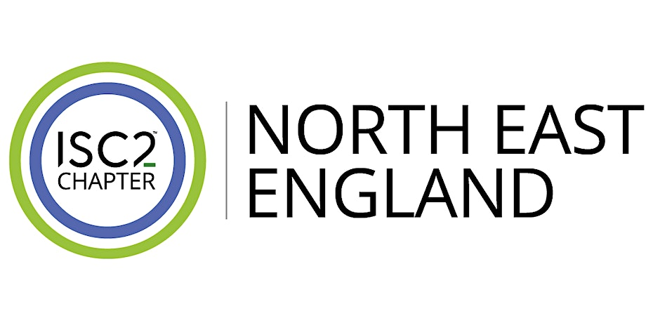

<!-- # ISC2 North East England Chapter November 2026 Meetup -->

<!--  -->

Join ISC2 North East England Chapter this November for an in-person meetup packed with cyber tips and networking!

**ISC2 North East England Chapter Meeting November 2026**

Come and join our in person event on 10 November at the Newcastle Building Society office at Cobalt Business park.

The ISC North East Chapter welcomes all ISC2 members, anyone working in cyber / infosec and students. Come join us for an evening to network and the usual: talk, talk, pizza, talk format.

## Agenda

**Lift and Shift - Nurse versus Architect**  
Graham Moor  

**From Vinyl to Vulnerabilities: My Journey into Information**  
Matt (NBS)  

~~**Continuous Threat Exposure Management (CTEM)**~~  
~~David Pearson - Softcat~~  

**Aon's Global Risk Management Survey**  
Kathryn Cardose  

**Overview of ISC2 Certifications**  
Steve Gilray  

## 🗓️ Date and time

🗓️ Tuesday 10 November  •  6 PM - 9 PM

## 📍 Location

📍 Newcastle Building Society  
1 Cobalt Park Way  
Wallsend NE28 9EJ  

## 🔗 Links

- https://www.eventbrite.co.uk/e/isc2-north-east-england-chapter-november-2026-tickets-2003668268729
- https://www.eventbrite.co.uk/o/isc2-north-east-england-chapter-13131159160
- https://www.isc2.org/chapters
- https://www.linkedin.com/company/isc-2-north-east-england/posts/
